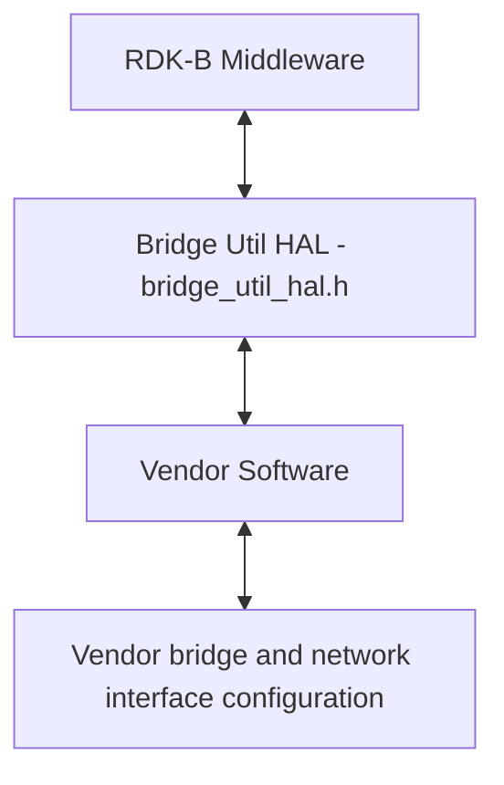
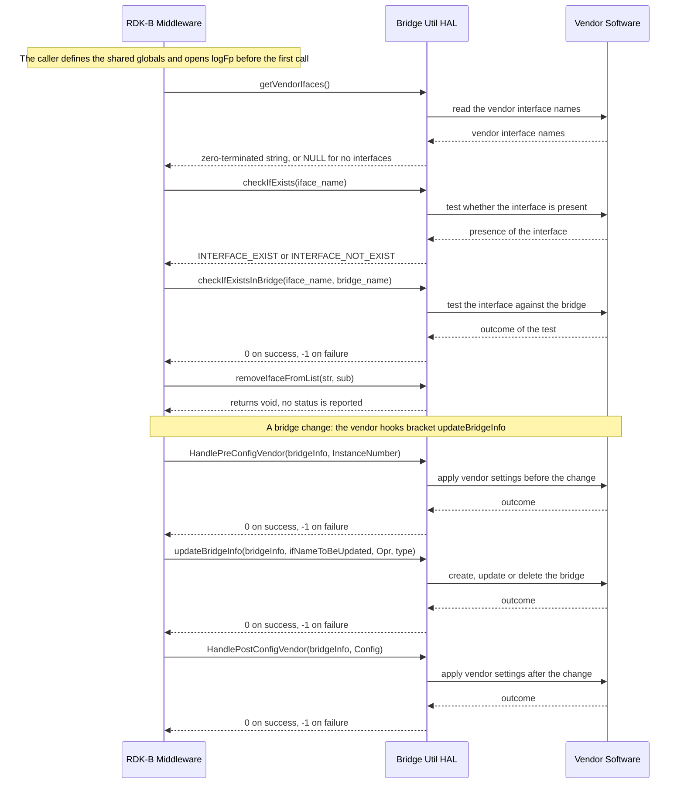

# Bridge Util HAL Documentation

## Version History

| Date | Comment | Version |
| --- | --- | --- |
| 2026-08-24 | Brought to the canonical `HAL` specification topic set. Every declared `API` is now named, the two misspelt identifiers in the sequence diagram are corrected, the four version identities are separated, and the interface's own return convention, public types and status values are documented. | 0.1.0 |

## Acronyms

- `HAL` \- Hardware Abstraction Layer
- `RDK-B` \- Reference Design Kit for Broadband Devices
- `OEM` \- Original Equipment Manufacturer
- `OVS` \- Open vSwitch
- `API` \- Application Programming Interface
- `SoC` \- System on Chip
- `GRE` \- Generic Routing Encapsulation
- `VLAN` \- Virtual Local Area Network
- `MoCA` \- Multimedia over Coax Alliance
- `QoS` \- Quality of Service
- `MTU` \- Maximum Transmission Unit
- `UTC` \- Coordinated Universal Time

## Description

The diagram below shows where the Bridge Util `HAL` sits in the `RDK-B` software stack.

The Bridge Util `HAL` is an abstraction layer through which the RDK-B Middleware drives vendor bridge configuration \- bridge modes, connection enable and disable, `QoS` configuration and IPv4 configuration \- without depending on how a particular platform implements it.

This repository holds the interface definition only; a vendor supplies the implementation. No dedicated middleware service owns this interface, so the RDK-B Middleware calls it directly.

The interface declares seven functions: two vendor hooks that bracket a bridge change, one function that creates, updates or deletes a bridge, three interface queries and one interface-list helper. A caller drives configuration by populating a bridge record and passing it through the hooks and `updateBridgeInfo`; the vendor implementation behind them applies the settings.

## Optional Components

The following components are optional and it is up to the vendor's discretion whether to use them.

- `MANAGE_WIFI_BRIDGE` \- the `enum Config` member with the value `17`, declared only when `WIFI_MANAGE_SUPPORTED` is defined.
- **The amenity bridges** \- `AMENITY_BRIDGE_2G`, `AMENITY_BRIDGE_5G` and `AMENITY_BRIDGE_6G`, with the values `20`, `21` and `22`, declared only when `AMENITIES_NETWORK_ENABLED` is defined **and** `_CBR2_PRODUCT_REQ_` is not.
- `network_interface.h` \- a types-only header declaring the gateway configuration record; a caller includes it only when it needs that record.

The seven declared functions are mandatory: a vendor implements every one of them in every build variant.

## Component Runtime Execution Requirements

### Initialization and Startup

The interface has no initialization or teardown function, handle or session, so a caller opens and closes nothing.

Two of the seven functions are vendor hooks, implemented by the vendor and invoked by the caller whenever it creates, updates or deletes a bridge, so that vendor-specific settings are applied around the change:

1. `HandlePreConfigVendor`
2. `HandlePostConfigVendor`

Their order relative to `updateBridgeInfo` is fixed; see `Method Sequencing`.

Before the first call, the caller's program defines the fifteen `extern` globals the interface declares, listed under `Data Structures and Defines`, and opens `logFp`, the stream the logging macro writes through.

Third-party vendors must implement appropriate handling to ensure operational requirements are met, including the hardware-readiness behaviour stated under `Blocking calls`.

### Threading Model

The interface is not required to be thread-safe.

**Caller obligation:** any module invoking the Bridge Util `HAL` `API` must ensure calls are made in a thread-safe manner. The obligation covers the fifteen caller-supplied globals, which are shared mutable state; the logging macro, for example, writes several of them on every logged message.

**Vendor latitude:** vendors may create internal threads and event mechanisms for operational needs, but must ensure synchronisation before closure cleanup.

### Process Model

`API`s are expected to be called from multiple processes. The caller-supplied globals are ordinary process-scoped symbols, so each process that links the interface has its own copies; arbitration between processes that drive bridge configuration concurrently is outside this interface.

### Memory Model

The caller owns the memory it passes to the interface; the implementation owns the memory it allocates for its own operation.

#### Caller Responsibilities

- Allocate, populate and release every buffer passed to the interface.
- Keep the `bridgeDetails` record and every string argument valid while the component drives bridge configuration through the interface, and do not rely on the implementation having copied them.
- Zero-terminate every string within its declared buffer size.
- Pass a writable list buffer to `removeIfaceFromList`, which edits the list in place.
- Read the string `getVendorIfaces` returns immediately and copy what is needed into caller-owned storage; free, retain or write through it only under an agreement with the vendor implementation.

#### Module Responsibilities

- Modules must allocate and de-allocate memory for their internal operations, ensuring efficient resource management.
- Modules are required to release all internally allocated memory upon closure to prevent resource leaks.

### Power Management Requirements

The `HAL` is not involved in any power management operation.

### Asynchronous Notification Model

There are no asynchronous notifications. `HandlePreConfigVendor` and `HandlePostConfigVendor` are not callbacks: the caller invokes them synchronously in its own flow.

### Blocking calls

**Synchronous and Responsive:** all `API`s operate synchronously and deliver their result as the return value at the point of call. Each is expected to complete within a period commensurate with the complexity of the operation.

**Hardware readiness:** the interface is expected to block until the underlying hardware is ready; a caller must therefore expect a bridge configuration sequence \- `HandlePreConfigVendor`, `updateBridgeInfo`, `HandlePostConfigVendor` \- to block.

### Internal Error Handling

**Synchronous Error Handling:** every Bridge Util `HAL` `API` reports its outcome synchronously as its return value.

**Internal Error Reporting:** the `HAL` handles system errors, such as an out-of-memory condition, internally, reports the outcome through the return value, and logs the detail needed for investigation; see `Logging and debugging requirements`.

| API | Return value | Caller action |
| --- | --- | --- |
| `updateBridgeInfo`, `checkIfExistsInBridge` | `0` on success, `-1` on failure | On `-1`, log the failure and either retry or report it to the vendor implementation's owner. Read `-1` from `checkIfExistsInBridge` as "not attached" only where the vendor implementation defines it so. |
| `HandlePreConfigVendor`, `HandlePostConfigVendor` | `0` when the vendor configuration was applied, `-1` on failure | On `-1`, log the failure and report it to the vendor implementation's owner. |
| `checkIfExists` | `INTERFACE_EXIST` (`0`) when the interface is present, `INTERFACE_NOT_EXIST` (`-1`) when it is absent | Treat `INTERFACE_NOT_EXIST` as an answer, not a failure: do not log it as an error or retry on it. |
| `getVendorIfaces` | A zero-terminated string of vendor interface names, or `NULL` when there are none | Treat `NULL` as "no interfaces", not as an error code. |
| `removeIfaceFromList` | `void`; when the named interface is not in the list, no action is taken | Inspect the list to learn whether the removal happened. |

### Persistence Model

There is no requirement for the `HAL` to persist any setting information.

## Non functional requirements

The following non functional requirements should be supported by the Bridge Util `HAL` component.

### Logging and debugging requirements

The component is required to record all errors and critical informative messages, to aid in identifying and debugging issues and in understanding the functional flow of the system. Logging may use `syslog` or `printf`; `syslog` is preferred where it is available.

Logs are written to the `bridgeUtils.log` file. The interface fixes its path as `BRIDGE_UTIL_LOG_FNAME`, `/rdklogs/logs/bridgeUtils.log`; the `/var/tmp/` directory is used instead only on a platform whose log partition is mounted elsewhere.

The interface supplies the `bridge_util_log` macro, which writes each message to the caller-defined `logFp` stream as a `UTC`-timestamped line of the form `YYYY-MM-DD HH:MM:SS ::: <message>`; a message logged while `logFp` is `NULL` is discarded. The macro expands to a brace-enclosed block that can evaluate its arguments twice, so a caller passes it side-effect-free arguments and braces it when it is the body of an `if`, `else`, `for` or `while`.

Implementations must not log credentials, secrets, security-sensitive information, or other sensitive data.

Logs must be categorised according to the following log levels, as defined by the Linux standard logging system, listed here in descending order of severity:

- **FATAL:** Critical conditions, typically indicating system crashes or severe failures that require immediate attention.
- **ERROR:** Non-fatal error conditions that nonetheless significantly impede normal operation.
- **WARNING:** Potentially harmful situations that do not yet represent errors.
- **NOTICE:** Important but not error-level events.
- **INFO:** General informational messages that highlight system operations.
- **DEBUG:** Detailed information typically useful only when diagnosing problems.
- **TRACE:** Very fine-grained logging to trace the internal flow of the system.

Each log entry should include a timestamp, the log level, and a message describing the event or condition.

### Memory and performance requirements

The component should not contribute disproportionately to memory or CPU utilisation during normal operation, and its resource use should be commensurate with the operation requested.

### Quality Control

The Bridge Util `HAL` implementation should pass checks using third-party tools such as `Coverity`, `Black Duck` and `Valgrind` without any reported issues, to ensure quality.

There should be no memory leaks or memory corruption introduced by the `HAL` or by the underlying third-party software implementation.

Any change to a file listed under `Source References` obliges a review of the topics in this document that rely on it. The responsible reviewer is the maintainer group the repository's contribution guide directs changes to: a change is raised as an issue, submitted as a pull request, and reviewed by the team before it is merged to the mainline.

### Licensing

The Bridge Util `HAL` implementation is expected to be released under the Apache License 2.0. Both interface headers carry an Apache 2.0 licence header, and the repository ships the corresponding `LICENSE`, `COPYING` and `NOTICE` files.

### Build Requirements

The source code should be able to be built under a Linux Yocto environment.

This repository ships the interface headers, documentation and licence files. The library name and toolchain of an implementation are those of the platform build that integrates the vendor implementation.

### Variability Management

Changes to the interface are controlled by versioning. Vendors are expected to implement a fixed version of the interface and, subject to their service agreements, to move to later versions as demand requires.

Each `API` interface is versioned using [Semantic Versioning 2.0.0](https://semver.org/spec/v2.0.0.html), and the vendor code complies with a specific version of the interface. The interface is versioned by the repository's release tags; this document describes release `1.3.0`.

**Compile-time flags:** `WIFI_MANAGE_SUPPORTED`, `AMENITIES_NETWORK_ENABLED` and `_CBR2_PRODUCT_REQ_` select which optional `enum Config` members are declared, as listed under `Optional Components`. They remove enumerators, never functions. Code that names an enumerator its build does not declare does not compile, and that enumerator's value must not be passed as an instance number in such a build.

**`OVS` dependency:** the interface was historically coupled to Open vSwitch through an `OvsAgentApi.h` include in `bridge_util_hal.h`. Release `1.1.1` removed that include and release `1.2.0` carries the wider dependency-removal work; the current headers include no `OVS` header and name no `OVS` type, so compiling against them carries no `OVS` build-time dependency.

**Migrating from a pre-`1.1.1` revision:** the `Opr` argument of `updateBridgeInfo` takes `enum BridgeOpr` \- `DELETE_BRIDGE` or `CREATE_BRIDGE`, cast to `int`. A caller that passed `enum OVS_CMD` values replaces each with the corresponding `BridgeOpr` member and must not assume the two enumerations agree on members or values.

### Platform or Product Customization

**Customizable by the platform or product:**

- **The declared configuration set**, through the compile-time flags under `Variability Management`.
- **The vendor interface names** `getVendorIfaces` returns; the values documented for the bridge record \- `eth0`, `moca0`, `wlan0`, `gre0` and the rest \- are examples rather than a fixed set.
- **The device role and platform topology**, through the caller-supplied globals such as `DeviceMode`, `primaryBridgeName`, `ethWanEnabled`, `ethWanIfaceName`, `MocaIsolation_Val` and `PORT2ENABLE`.
- **The behaviour behind the hooks:** `HandlePreConfigVendor` and `HandlePostConfigVendor` apply `OEM` and `SoC` specific configuration without changing the caller.
- **The log directory**, as recorded under `Logging and debugging requirements`.

**Not customizable:**

- The seven declared function signatures.
- The `0` and `-1` return convention and the two named interface-existence constants.
- The log file name and the timestamp format the logging macro emits.
- The fixed buffer sizes in the bridge record and the gateway configuration record.

## Interface API Documentation

All `HAL` function prototypes are declared in `bridge_util_hal.h`.

1. Components and processes must include `bridge_util_hal.h` to make use of Bridge Util `HAL` capabilities.
2. Components and processes that need the gateway configuration record must additionally include `network_interface.h`, which `bridge_util_hal.h` does not include.

### Theory of operation and key concepts

The interface has a small conceptual surface: one record describing a bridge, a set of caller-supplied globals describing the platform, and seven functions of which two are vendor hooks. The sub-topics below cover what a caller owns, the order it calls in, and where an argument's range differs from its declared type.

#### Object Lifecycles

The caller's `bridgeDetails` record is the only structured object passed to the interface. The caller creates and populates it, passes it by pointer to `updateBridgeInfo`, `HandlePreConfigVendor` and `HandlePostConfigVendor`, which read it without writing it, and releases it when it stops driving bridge configuration; no function creates, copies or destroys it.

The fifteen caller-supplied globals are defined by the caller's program and live for its lifetime; `Initialization and Startup` states what must be in place before the first call.

#### Method Sequencing

The declarations of the two vendor hooks fix one ordering: the caller calls `HandlePreConfigVendor` before `updateBridgeInfo` and `HandlePostConfigVendor` after it.

`HandlePreConfigVendor` → `updateBridgeInfo` → `HandlePostConfigVendor`

The bracketing ensures vendor-specific settings are applied before and after every change `updateBridgeInfo` makes to a bridge \- creation, update or deletion.

`checkIfExists`, `checkIfExistsInBridge`, `getVendorIfaces` and `removeIfaceFromList` have no pre-condition and no position in that sequence.

#### State-Dependent Behavior

Four parameters are declared as plain `int` while their valid ranges are enumerations; the caller casts the enumerator to `int`. Any other value is outside the contract.

| Parameter | Declared type | Range the caller must cast from |
| --- | --- | --- |
| `Opr` of `updateBridgeInfo` | `int` | `enum BridgeOpr` \- `DELETE_BRIDGE` or `CREATE_BRIDGE`. |
| `type` of `updateBridgeInfo` | `int` | `enum INTERFACE_TYPE`. |
| `InstanceNumber` of `HandlePreConfigVendor` | `int` | `enum Config`. |
| `Config` of `HandlePostConfigVendor` | `int` | `enum Config`. |

**Sync case of `updateBridgeInfo`:** `ifNameToBeUpdated` names the interface to be deleted and updated and applies only during sync; the documented example values are `moca0`, `wifi0` and `eth0`. In the sync-delete case the `type` argument is `IF_OTHER_BRIDGEUTIL` rather than the interface's own type.

### Data Structures and Defines

A caller of this interface constructs or interprets the types below. Each group names its header and what each member represents; the field-level and enumerator-level documentation lives on the declarations.

**Macro constants** \- `bridge_util_hal.h`.

| Constant | Value | Represents |
| --- | --- | --- |
| `BRIDGE_UTIL_LOG_FNAME` | `/rdklogs/logs/bridgeUtils.log` | The log file this interface writes diagnostic output to. |
| `GRE_HANDLER_SCRIPT` | `/etc/utopia/service.d/service_multinet/handle_gre.sh` | The platform-provided helper script for `GRE` handling that this interface names. |
| `TOTAL_IFLIST_SIZE` | `1024` | The bound on a complete interface list. |
| `BRIDGE_NAME_SIZE` | `64` | The buffer size for a bridge, `VLAN` or virtual parent interface name in the bridge record. |
| `IFACE_NAME_SIZE` | `64` | The buffer size for a single interface name. |
| `IFLIST_SIZE` | `256` | The buffer size for each per-technology interface list in the bridge record. |
| `MAX_LOG_BUFF_SIZE` | `1024` | The bound on a formatted log message. |
| `TIMESTAMP` | `64` | The room reserved for the timestamp prefix on a log message. |
| `INTERFACE_EXIST` | `0` | The named success value reported by `checkIfExists` when the interface is present. |
| `INTERFACE_NOT_EXIST` | `-1` | The named value reported by `checkIfExists` when the interface is absent. |

**Caller-supplied globals** \- `bridge_util_hal.h`. These fifteen symbols are declared `extern` by the interface and defined by the caller's program. They are shared mutable state; see `Threading Model` and `Process Model`.

| Symbol | Type | Represents |
| --- | --- | --- |
| `DeviceMode` | `int` | The device role: router is `0` and bridge is `2`. |
| `MocaIsolation_Val` | `int` | The platform's `MoCA` isolation setting. |
| `need_wifi_gw_refresh` | `int` | Flag indicating that a Wi-Fi gateway refresh is needed. |
| `need_switch_gw_refresh` | `int` | Flag indicating that a switch gateway refresh is needed. |
| `syncMembers` | `int` | Synchronisation marker for bridge member updates. |
| `BridgeOprInPropgress` | `int` | Marker that a bridge operation is in progress. The spelling is the interface's own. |
| `logFp` | `FILE *` | The stream the logging macro writes through. |
| `log_buff` | `char[MAX_LOG_BUFF_SIZE]` | Scratch buffer for the formatted log message. |
| `log_msg_wtime` | `char[MAX_LOG_BUFF_SIZE + TIMESTAMP]` | Scratch buffer for the log message with its timestamp prefix. |
| `primaryBridgeName` | `char[64]` | The platform's primary bridge name. |
| `PORT2ENABLE` | `int` | Platform-specific port enable state. |
| `ethWanEnabled` | `int` | Whether an Ethernet `WAN` is enabled. |
| `ethWanIfaceName` | `char[64]` | The Ethernet `WAN` interface name. |
| `timeinfo` | `struct tm *` | Broken-down time used to build the log timestamp. |
| `utc_time` | `time_t` | The `UTC` time value used to build the log timestamp. |

`enum Config` \- `bridge_util_hal.h`. The configuration instance a vendor hook is being invoked for, cast to `int` at the call. The values are not contiguous, so a caller uses the enumerators and never arithmetic on them.

| Enumerator | Value | Represents |
| --- | --- | --- |
| `PRIVATE_LAN` | `1` | The private `LAN` bridge. |
| `HOME_SECURITY` | `2` | The home security bridge. |
| `HOTSPOT_2G` | `3` | The 2.4 GHz hotspot bridge. |
| `HOTSPOT_5G` | `4` | The 5 GHz hotspot bridge. |
| `LOST_N_FOUND` | `6` | The lost-and-found bridge. |
| `HOTSPOT_SECURE_2G` | `7` | The secure 2.4 GHz hotspot bridge. |
| `HOTSPOT_SECURE_5G` | `8` | The secure 5 GHz hotspot bridge. |
| `MOCA_ISOLATION` | `9` | The `MoCA` isolation bridge. |
| `MESH_BACKHAUL` | `10` | The mesh backhaul bridge. |
| `ETH_BACKHAUL` | `11` | The Ethernet backhaul bridge. |
| `MESH` | `12` | The mesh bridge. |
| `MESH_WIFI_BACKHAUL_2G` | `13` | The 2.4 GHz mesh Wi-Fi backhaul bridge. |
| `MESH_WIFI_BACKHAUL_5G` | `14` | The 5 GHz mesh Wi-Fi backhaul bridge. |
| `MESH_ONBOARD` | `18` | The mesh onboarding bridge. |
| `MESH_WIFI_ONBOARD_2G` | `19` | The 2.4 GHz mesh Wi-Fi onboarding bridge. |
| `MANAGE_WIFI_BRIDGE` | `17` | The managed Wi-Fi bridge. Declared only under `WIFI_MANAGE_SUPPORTED`. |
| `AMENITY_BRIDGE_2G` | `20` | The 2.4 GHz amenity bridge. Conditional; see `Optional Components`. |
| `AMENITY_BRIDGE_5G` | `21` | The 5 GHz amenity bridge. Conditional; see `Optional Components`. |
| `AMENITY_BRIDGE_6G` | `22` | The 6 GHz amenity bridge. Conditional; see `Optional Components`. |

`enum INTERFACE_TYPE` \- `bridge_util_hal.h`. The kind of interface an `updateBridgeInfo` call concerns, cast to `int` at the call.

| Enumerator | Value | Represents |
| --- | --- | --- |
| `IF_BRIDGE_BRIDGEUTIL` | `1` | A bridge interface. |
| `IF_VLAN_BRIDGEUTIL` | `2` | A `VLAN` interface. |
| `IF_GRE_BRIDGEUTIL` | `3` | A `GRE` interface. |
| `IF_MOCA_BRIDGEUTIL` | `4` | A `MoCA` interface. |
| `IF_WIFI_BRIDGEUTIL` | `5` | A Wi-Fi interface. |
| `IF_ETH_BRIDGEUTIL` | `6` | An Ethernet interface. |
| `IF_OTHER_BRIDGEUTIL` | implicitly `7` | Any interface type not listed above. |

`enum BridgeOpr` \- `bridge_util_hal.h`. The operation an `updateBridgeInfo` call performs, cast to `int` at the call.

| Enumerator | Value | Represents |
| --- | --- | --- |
| `DELETE_BRIDGE` | `0` | Delete the bridge. |
| `CREATE_BRIDGE` | `1` | Create the bridge. |

`bridgeDetails` \- `bridge_util_hal.h`. The bridge record a caller populates and passes by pointer. Eight fields; the example values are those the declaration documents.

| Field | Type | Represents |
| --- | --- | --- |
| `bridgeName` | `char[BRIDGE_NAME_SIZE]` | The bridge name, such as `brlan0`, `brlan1`, `privbr` or `br-home`. |
| `vlan_name` | `char[BRIDGE_NAME_SIZE]` | The `VLAN` name, such as `vlan1`, `vlan10` or `guest_vlan`. |
| `VirtualParentIfname` | `char[BRIDGE_NAME_SIZE]` | The virtual parent interface name, such as `eth0`, `eth1` or `wan0`. |
| `vlanID` | `int` | The `VLAN` identifier, such as `1`, `2`, `3`, `10` or `100`. |
| `ethIfList` | `char[IFLIST_SIZE]` | The Ethernet interface list, such as `eth0`, `eth1`, `eth2`. |
| `MoCAIfList` | `char[IFLIST_SIZE]` | The `MoCA` interface list, such as `moca0`, `moca1`. |
| `GreIfList` | `char[IFLIST_SIZE]` | The `GRE` interface list, such as `gre0`, `gre1`. |
| `WiFiIfList` | `char[IFLIST_SIZE]` | The Wi-Fi interface list, such as `wlan0`, `wlan1`. |

**Logging macro** \- `bridge_util_hal.h`. `bridge_util_log` is a variadic macro taking a format string and its arguments. Its behaviour is described under `Logging and debugging requirements`.

**Size constants** \- `network_interface.h`.

| Constant | Value | Represents |
| --- | --- | --- |
| `MAX_IF_NAME_SIZE` | `16` | The buffer size for a network interface name, including the terminating null character. |
| `MAX_IP_ADDR_SIZE` | `16` | The buffer size for a dotted-quad IPv4 address string, including the terminating null character. |
| `MAX_BRIDGE_NAME_SIZE` | `16` | The buffer size for a network bridge name, including the terminating null character. |

`IF_TYPE` \- `network_interface.h`. The interface type used by the gateway configuration record. Distinct from `enum INTERFACE_TYPE` above, which belongs to the other header and has different members.

| Enumerator | Value | Represents |
| --- | --- | --- |
| `OTHER_IF_TYPE` | `0` | Some other network interface type. |
| `BRIDGE_IF_TYPE` | implicitly `1` | A network bridge interface. |
| `ETH_IF_TYPE` | implicitly `2` | A network Ethernet interface. |
| `GRE_IF_TYPE` | implicitly `3` | A network `GRE` interface. |
| `VLAN_IF_TYPE` | implicitly `4` | A network `VLAN` interface. |

`BR_CMD` \- `network_interface.h`. The command the gateway configuration record carries for an interface or bridge.

| Enumerator | Value | Represents |
| --- | --- | --- |
| `IF_UP_CMD` | `0` | Bring the network interface up. |
| `IF_DOWN_CMD` | implicitly `1` | Take the network interface down. |
| `IF_DELETE_CMD` | implicitly `2` | Delete the network interface. |
| `BR_REMOVE_CMD` | implicitly `3` | Remove the network bridge. |

`Gateway_Config_Non_Ovs_Bridge` \- `network_interface.h`. The gateway configuration record; its name marks it as the non-`OVS` form. Eleven fields.

| Field | Type | Represents |
| --- | --- | --- |
| `if_name` | `char[MAX_IF_NAME_SIZE]` | The network interface name. |
| `inet_addr` | `char[MAX_IP_ADDR_SIZE]` | The network IP address. |
| `netmask` | `char[MAX_IP_ADDR_SIZE]` | The network netmask. |
| `gre_remote_inet_addr` | `char[MAX_IP_ADDR_SIZE]` | The `GRE` remote IP address. |
| `gre_local_inet_addr` | `char[MAX_IP_ADDR_SIZE]` | The `GRE` local IP address. |
| `parent_ifname` | `char[MAX_IF_NAME_SIZE]` | The parent network interface name. |
| `parent_bridge` | `char[MAX_BRIDGE_NAME_SIZE]` | The parent network bridge name. |
| `mtu` | `int` | The `MTU` packet size in bytes. |
| `vlan_id` | `int` | The `VLAN` identifier. |
| `if_type` | `IF_TYPE` | The network interface type. |
| `if_cmd` | `BR_CMD` | The network interface or bridge command. |

### API Surface

All seven functions are declared in `bridge_util_hal.h` and are grouped below by role. Their Doxygen blocks carry the per-`API` detail: parameter ranges, ownership, pre-conditions and return values.

**Vendor hooks \- 2 declared functions.** Implemented by the vendor and called by the caller either side of a bridge change, so that `OEM` and `SoC` specific configuration is applied around it.

| API | Purpose |
| --- | --- |
| `HandlePreConfigVendor` | Applies vendor-specific configuration before the caller calls `updateBridgeInfo`. |
| `HandlePostConfigVendor` | Applies vendor-specific configuration after the caller calls `updateBridgeInfo`. |

**Bridge mutation \- 1 declared function.**

| API | Purpose |
| --- | --- |
| `updateBridgeInfo` | Creates, updates or deletes a bridge according to the operation and interface type supplied, and handles the sync-delete case. |

**Interface queries \- 3 declared functions.**

| API | Purpose |
| --- | --- |
| `checkIfExists` | Reports whether a named interface exists. |
| `checkIfExistsInBridge` | Reports the outcome of testing whether a named interface is attached to a named bridge. |
| `getVendorIfaces` | Retrieves the vendor-specific interface names available for bridge management. |

**Interface-list mutation \- 1 declared function.**

| API | Purpose |
| --- | --- |
| `removeIfaceFromList` | Removes a named interface from a caller-supplied interface list, taking no action and reporting nothing if it is absent. |

### Sequence Diagram

The exchange below shows the RDK-B Middleware calling all seven declared functions, with the vendor hooks bracketing `updateBridgeInfo`.

### State Diagram

The interface defines the status values below but no transitions between them; a caller must not infer an ordering from the order in which they are declared.

| Value or enumeration | What it reports |
| --- | --- |
| `INTERFACE_EXIST`, `INTERFACE_NOT_EXIST` | Whether a named interface is present, as reported by `checkIfExists`. |
| `enum BridgeOpr` | `DELETE_BRIDGE` or `CREATE_BRIDGE`: the operation a caller requests of `updateBridgeInfo`. |
| `BR_CMD` | `IF_UP_CMD`, `IF_DOWN_CMD`, `IF_DELETE_CMD` or `BR_REMOVE_CMD`: the command carried in the gateway configuration record. |
| `DeviceMode` | Router operation, `0`, or bridge operation, `2`. |
| `BridgeOprInPropgress` | That a bridge operation is in progress. |

## Source References

- [rdkcentral/rdkb-halif-bridge-util/include/bridge_util_hal.h](https://github.com/rdkcentral/rdkb-halif-bridge-util/blob/develop/include/bridge_util_hal.h) — functions, bridge record, enumerations, constants, caller-supplied globals and logging macro
- [rdkcentral/rdkb-halif-bridge-util/include/network_interface.h](https://github.com/rdkcentral/rdkb-halif-bridge-util/blob/develop/include/network_interface.h) — gateway configuration record types
- [rdkcentral/rdkb-halif-bridge-util/CHANGELOG.md](https://github.com/rdkcentral/rdkb-halif-bridge-util/blob/develop/CHANGELOG.md) — release history
- [rdkcentral/rdkb-halif-bridge-util/CONTRIBUTING.md](https://github.com/rdkcentral/rdkb-halif-bridge-util/blob/develop/CONTRIBUTING.md) — contribution and review process
- [rdkcentral/rdkb-halif-bridge-util/LICENSE](https://github.com/rdkcentral/rdkb-halif-bridge-util/blob/develop/LICENSE) — Apache License 2.0
- [rdkcentral/rdkb-halif-bridge-util/NOTICE](https://github.com/rdkcentral/rdkb-halif-bridge-util/blob/develop/NOTICE) — copyright notices
